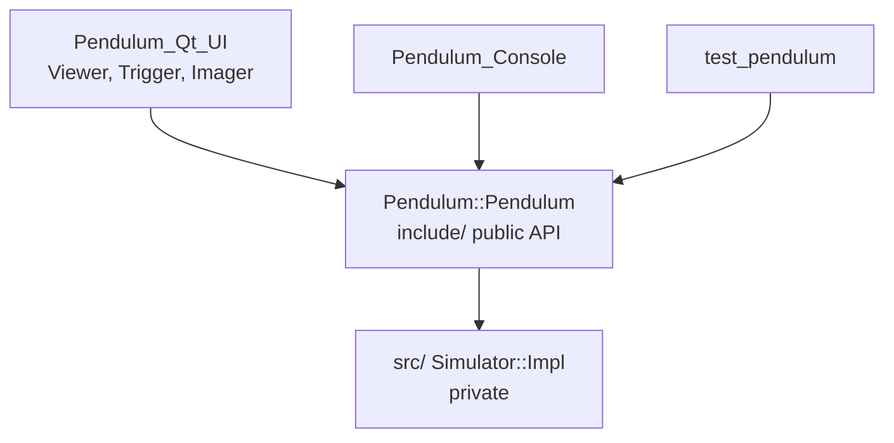

# Architecture

Pendulum is one library and two applications, built with
[buildkit](https://github.com/medaminben/buildkit). The
library steps the physics and reports the bob position; the applications
print or draw that position.

## Layers

| Layer | Path | Responsibility |
|-------|------|----------------|
| Applications | `applications/Pendulum/` | Entry points; link only `Pendulum::Pendulum` (and Qt for the viewer) |
| Public API | `libraries/Pendulum/include/Pendulum/` | `Simulator`, constants, export macro |
| Implementation | `libraries/Pendulum/src/` | `Simulator::Impl`: state, physics step, worker thread |
| Tests | `libraries/Pendulum/test/` | GoogleTest against the public API |
| Build | `cmake/` | Target helpers, warnings, coverage, install, scaffolding |

Dependencies point down only. The library does not include Qt; Qt stays in
`Pendulum_Qt_UI`.

## The library

`Simulator` hides its state behind a pimpl (`struct Impl`), so the public
header carries no `<thread>` or `<atomic>`. The physics model, units and
threading rules are in the [library README](../libraries/Pendulum/README.md).

## The Qt viewer

| Class | File | Role |
|-------|------|------|
| `Viewer` | `Viewer.h`, `Viewer.cpp`, `Viewer.ui` | Main window. Owns the `Simulator` and a `Trigger`, starts both, and on each frame draws the current position into the label. The **hold** button stops and restarts the `Trigger`. |
| `Trigger` | `Trigger.h` | Wraps a precise `QTimer` and emits `frameReady` every 1000/`fps` ms (16 ms). |
| `Imager` | `Imager.h`, `Imager.cpp` | Draws one frame: a cached grey gradient of 2736 × 2192 px, the rod and the bob. |

The simulation thread and the redraw timer are independent. The viewer
samples the position; it does not drive the physics.

## Targets and names

| Kind | Pattern | Here |
|------|---------|------|
| CMake package | `Pendulum` | `find_package(Pendulum)` |
| Alias target | `Pendulum::<Lib>` | `Pendulum::Pendulum` |
| Raw target | `<Lib>` | `Pendulum` |
| Library file | `<Lib>` | `libPendulum.so` |
| Test executable | `test_<lib>`, lowercase | `test_pendulum` |
| Include path | `<Lib>/<Header>.h` | `#include <Pendulum/Pendulum.h>` |
| Export header, macro | `<Lib>_export.h`, `<LIB>_API` | `Pendulum_export.h`, `PENDULUM_API`, generated in the build tree |
| Namespace | `<Lib>` | `Pendulum::Simulator` |

## Build

The CMake modules come from [buildkit](https://github.com/medaminben/buildkit), pinned to `v2.0.0` in
`cmake/buildkit.cmake`. Pendulum uses its flat layout (no `CMAKE_ROOT_NAME`):

| Pendulum file | Role |
|---------------|------|
| `CMakeLists.txt` | Loads buildkit, sets the version from git tags, options, library list |
| `cmake/buildkit.cmake` | buildkit's loader, copied unchanged |
| `cmake/QtSupport.cmake` | Finds Qt 6, falling back to Qt 5, for `BUILD_QT_UI` |
| `libraries/Pendulum/CMakeLists.txt` | `create_library` |
| `applications/Pendulum/Pendulum_Console/CMakeLists.txt` | `create_application` (Console) |
| `applications/Pendulum/Pendulum_Qt_UI/CMakeLists.txt` | Plain `add_executable`; buildkit has no Qt entry |

`create_library`, `create_application`, warnings, coverage, GoogleTest,
install and the scaffold generator are buildkit's; see its
[README](https://github.com/medaminben/buildkit#modules).

## Known issues

- **Data race on the position.** The worker thread writes `angle`, `pos_x` and
  `pos_y` as plain floats while the viewer reads them through `position()`
  (`libraries/Pendulum/src/Pendulum_impl.h`). Fix: guard the state with a
  mutex or publish the position atomically.
- **`set_hold(false)` does not resume.** The worker loop ends on hold;
  only `start()` restarts it. The header comment says "Pause / resume".
- **Scene size in the physics library.** `width` and `height` describe the
  viewer's image, not the pendulum, but live in `Constants.h`.
